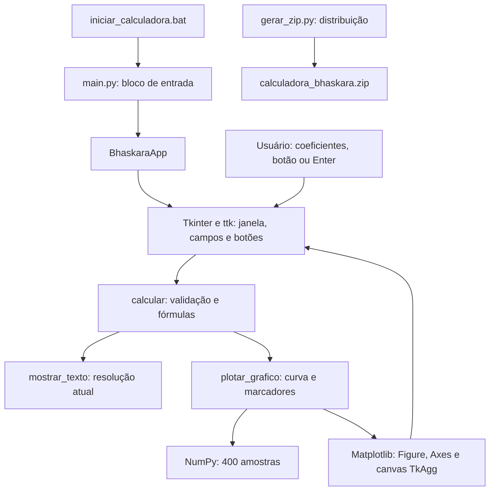
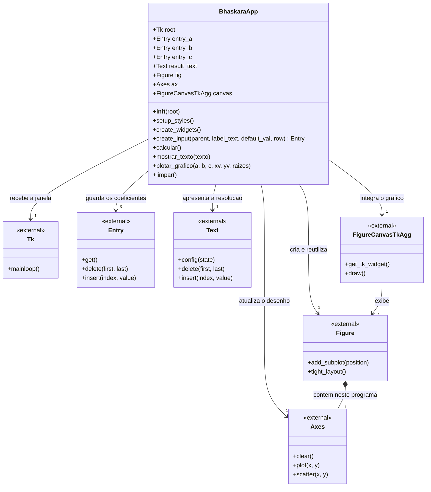
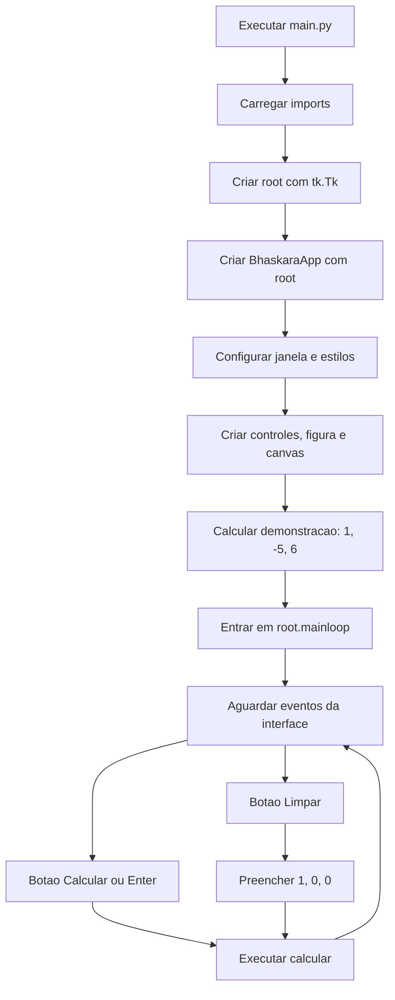
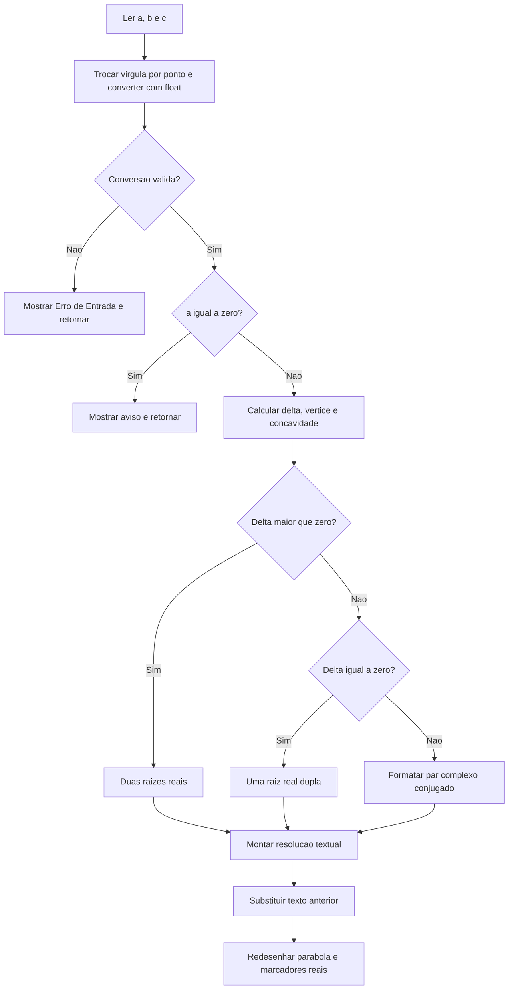
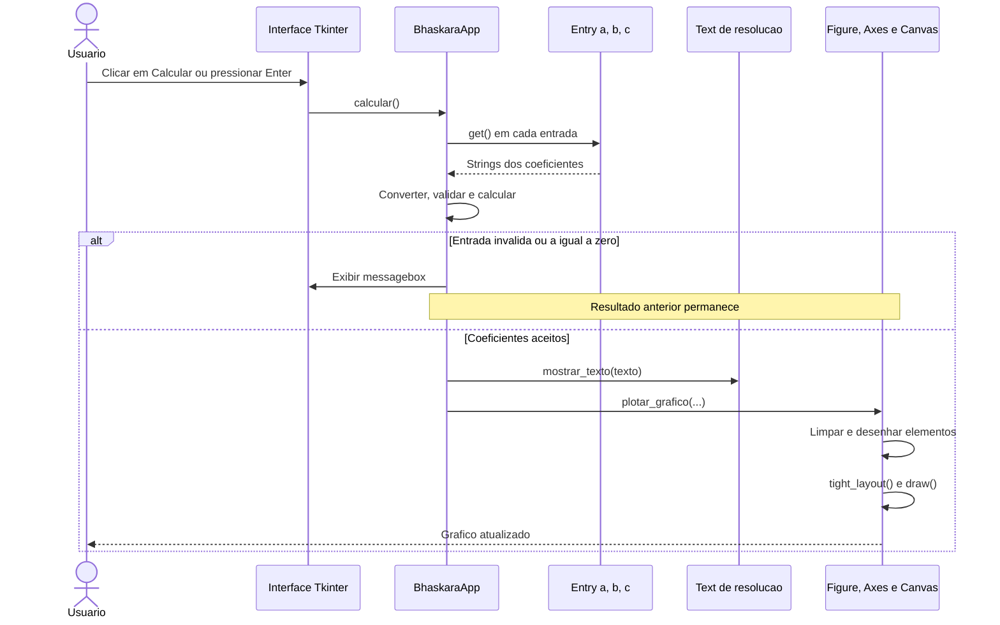
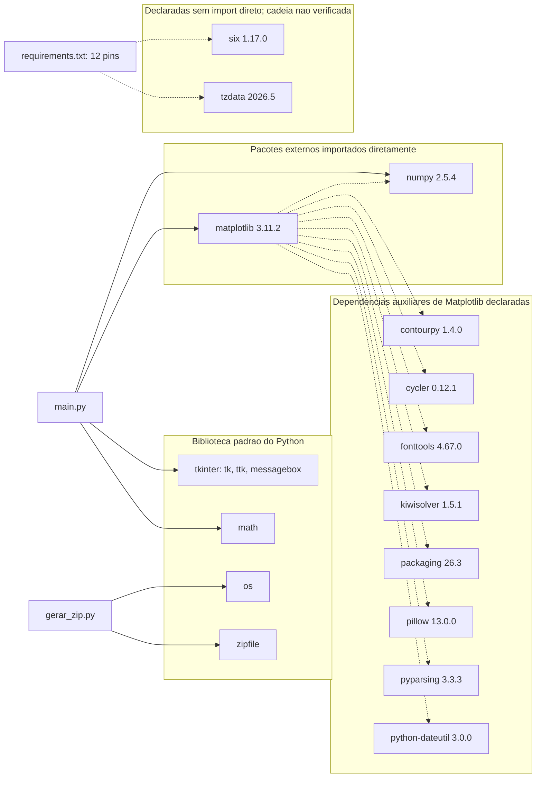
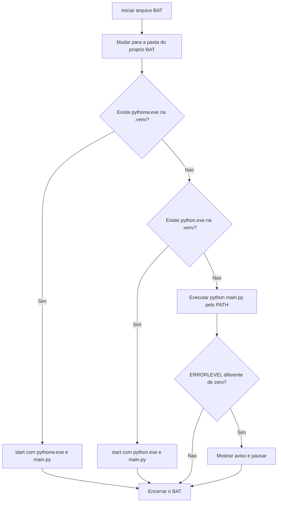
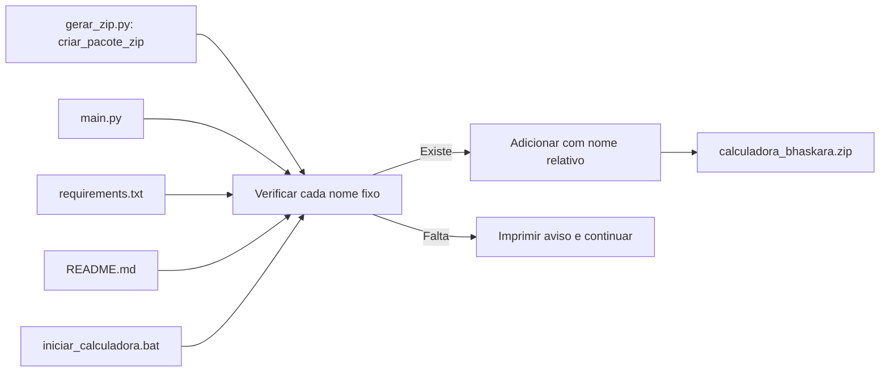

# Calculadora Desktop de Equações do 2º Grau

Aplicação desktop em Python (**Tkinter + NumPy + Matplotlib**) para resolver equações da forma **ax² + bx + c = 0**, apresentar a resolução passo a passo e desenhar a parábola correspondente em uma interface com tema escuro.

Este README reúne a documentação funcional, matemática, arquitetural e operacional do projeto, incluindo os diagramas de classes, componentes, bibliotecas, execução e distribuição. A explicação acompanha os arquivos efetivamente presentes no repositório.

> **Referência da análise:** repositório [dansfisica85/testes_py](https://github.com/dansfisica85/testes_py), branch `main`, código da revisão [`2c82423cbe7ffe77c690519840a9163b17daa443`](https://github.com/dansfisica85/testes_py/tree/2c82423cbe7ffe77c690519840a9163b17daa443), consultado em **30/10/2026**. A alteração que publica esta documentação modifica apenas o README; as descrições técnicas abaixo se referem ao código dessa revisão.

## Sumário

1. [Objetivo, público e funcionalidades](#01-objetivo)
2. [Estrutura completa do repositório](#02-estrutura)
3. [Arquitetura e responsabilidades](#03-arquitetura)
4. [Interface gráfica e experiência de uso](#04-interface)
5. [Diagrama de classes UML](#05-classes)
6. [Atributos e estado da aplicação](#06-atributos)
7. [Referência detalhada de todos os métodos](#07-metodos)
8. [Fundamentação matemática e exemplos](#08-matematica)
9. [Fluxos de inicialização e cálculo](#09-fluxos)
10. [Construção e atualização do gráfico](#10-grafico)
11. [Bibliotecas, versões e diagrama de dependências](#11-bibliotecas)
12. [Preparação do ambiente e execução](#12-execucao)
13. [Funcionamento do iniciador Windows](#13-iniciador)
14. [Empacotamento e conteúdo do ZIP](#14-zip)
15. [Arquivos didáticos e cache](#15-didaticos)
16. [Entradas, mensagens e tratamento de erros](#16-erros)
17. [Verificações realizadas e roteiro de testes](#17-verificacao)
18. [Limitações técnicas e decisões atuais](#18-limites)
19. [Manutenção e possíveis evoluções](#19-manutencao)
20. [Glossário e referências](#20-referencias)

<a id="01-objetivo"></a>
## 1. Objetivo, público e funcionalidades

O projeto transforma os três coeficientes de uma equação quadrática em duas formas complementares de explicação: uma resolução numérica detalhada e uma representação gráfica de `f(x) = ax² + bx + c`. Isso permite relacionar o sinal do discriminante, as raízes, o vértice e a concavidade da parábola.

O conteúdo e os arquivos auxiliares indicam uso didático: há um rascunho com conceitos básicos de Python e um registro de aula. A aplicação também pode ser utilizada para conferir exercícios com coeficientes numéricos, respeitadas as limitações de precisão e validação descritas neste documento.

### 1.1. Funcionalidades implementadas

| Recurso | Comportamento efetivo |
|---|---|
| Entrada de coeficientes | Três campos separados para `a`, `b` e `c`. |
| Números decimais | Aceita ponto ou vírgula decimal por substituição simples antes de `float()`. |
| Discriminante | Calcula `Δ = b² − 4ac` e mostra a substituição dos valores. |
| Duas raízes reais | Quando `Δ > 0`, calcula e apresenta `x₁` e `x₂`. |
| Raiz real dupla | Quando `Δ = 0`, apresenta a raiz repetida e marca um ponto de raiz no gráfico. |
| Raízes complexas | Quando `Δ < 0`, mostra o par conjugado no painel textual. |
| Vértice | Calcula `Xv = −b/(2a)` e `Yv = −Δ/(4a)`. |
| Concavidade | Informa abertura para cima/mínimo ou para baixo/máximo conforme o sinal de `a`. |
| Gráfico integrado | Desenha a parábola, os eixos, a grade, o vértice e as raízes reais. |
| Resolução passo a passo | Exibe a equação, o discriminante, as raízes e o vértice em uma área de texto. |
| Comando pelo teclado | Enter em qualquer campo executa o cálculo. |
| Botão Limpar | Redefine os coeficientes para `1`, `0`, `0` e calcula novamente. |
| Demonstração inicial | Ao abrir, resolve `x² − 5x + 6 = 0`. |
| Inicialização Windows | O arquivo `.bat` procura um Python local no ambiente `.venv` antes do Python do sistema. |
| Distribuição por ZIP | Um script reúne quatro arquivos de distribuição em um arquivo compactado. |

### 1.2. O que o usuário faz

1. Abre o programa em um ambiente com as dependências instaladas.
2. Informa os coeficientes de uma equação com `a` diferente de zero.
3. Clica em **Calcular Raízes** ou pressiona **Enter** em um dos campos.
4. Lê o desenvolvimento no painel esquerdo e compara o resultado com a curva à direita.
5. Altera os coeficientes para experimentar outra equação ou utiliza **Limpar** para voltar ao estado `x² = 0`.

O campo de entrada recebe somente o número de cada coeficiente. Por exemplo, para `2x² − 3x + 1 = 0`, digite `2`, `-3` e `1`; não digite a equação completa em um único campo.

<a id="02-estrutura"></a>
## 2. Estrutura completa do repositório

A árvore abaixo representa os arquivos encontrados na revisão analisada. O conteúdo do README é atualizado pela presente documentação.

```text
testes_py/
├── README.md
├── README.txtr
├── main.py
├── main.txt
├── requirements.txt
├── iniciar_calculadora.bat
├── gerar_zip.py
├── calculadora_bhaskara.zip
└── __pycache__/
    └── main.cpython-314.pyc
```

### 2.1. Responsabilidade de cada arquivo

| Caminho | Papel | Participação na execução principal |
|---|---|---|
| [`main.py`](main.py) | Implementa a classe `BhaskaraApp`, a interface, o cálculo e o gráfico. | É o ponto de entrada da aplicação desktop. |
| [`requirements.txt`](requirements.txt) | Lista 12 distribuições Python com versões fixadas por `==`. | É consumido pelo instalador `pip`; o programa não o lê durante o cálculo. |
| [`iniciar_calculadora.bat`](iniciar_calculadora.bat) | Facilita a abertura no Windows e seleciona o interpretador. | Executa `main.py`. |
| [`gerar_zip.py`](gerar_zip.py) | Define a função `criar_pacote_zip()` e a chama quando executado diretamente. | É uma ferramenta de distribuição separada da calculadora. |
| [`calculadora_bhaskara.zip`](calculadora_bhaskara.zip) | Pacote de fontes já gerado e versionado. | Deve ser extraído; não é um executável independente. |
| [`README.md`](README.md) | Explica uso, estrutura, matemática, dependências e manutenção. | Não é importado pelo código. |
| [`README.txtr`](README.txtr) | Registro curto com o nome do repositório e uma data de aula. | Não é carregado pela aplicação. |
| [`main.txt`](main.txt) | Rascunho didático com variáveis, condicionais, fórmula e tipos. | Não é importado por `main.py`. |
| [`__pycache__/main.cpython-314.pyc`](__pycache__/main.cpython-314.pyc) | Cache de bytecode associado ao CPython 3.14. | Não substitui o código-fonte e não define a versão mínima suportada. |

### 2.2. Arquivos que não estão presentes nessa revisão

Não foram encontrados `pyproject.toml`, `setup.py`, `.python-version`, `.gitignore`, pasta de testes ou configuração de integração contínua. Assim, não há uma declaração formal própria de versão mínima de Python nem uma suíte automatizada versionada no projeto analisado.

A pasta `.venv` mencionada no README e no iniciador é um ambiente a ser criado na máquina do usuário; ela não é fornecida pelo repositório nem pelo ZIP.

<a id="03-arquitetura"></a>
## 3. Arquitetura e responsabilidades

### 3.1. Organização atual

A aplicação é **desktop e orientada a eventos**. O Tkinter mantém a janela e chama os métodos associados aos botões e à tecla Enter. O processamento matemático e a atualização da apresentação acontecem de forma síncrona nesses callbacks.

Existe **uma única classe própria na aplicação**, `BhaskaraApp`. Ela reúne quatro responsabilidades:

1. Configurar a janela e o tema visual.
2. Criar e administrar os controles gráficos.
3. Ler os coeficientes e calcular a solução.
4. Atualizar o texto e redesenhar o gráfico.

O empacotador é uma função em outro arquivo. Não há uma classe separada para equação, raiz, serviço matemático ou repositório de dados. Os diagramas representam essa estrutura real; uma eventual separação futura está descrita apenas como proposta de manutenção.

### 3.2. Diagrama de componentes e responsabilidades



As caixas `calcular`, `mostrar_texto` e `plotar_grafico` são responsabilidades e métodos da mesma classe, não serviços independentes. O empacotador não participa do fluxo de cada cálculo.

### 3.3. Fluxo dos dados

| Etapa | Entrada | Transformação | Saída |
|---|---|---|---|
| Leitura | Texto de três `Entry`. | Troca `,` por `.` e executa `float`. | Três valores numéricos. |
| Validação | Valores convertidos. | Rejeita `a == 0`. | Coeficientes aceitos ou mensagem. |
| Cálculo | `a`, `b`, `c`. | Calcula discriminante, raízes e vértice. | Variáveis locais numéricas e linhas de explicação. |
| Texto | Lista `res`. | Junta as linhas com `\n`. | Conteúdo exibido em `result_text`. |
| Gráfico | Coeficientes, vértice e raízes reais. | Amostra a função e atualiza elementos gráficos. | Figura integrada à janela. |

Os valores matemáticos não são persistidos em banco de dados ou arquivo. O resultado anterior é substituído a cada cálculo válido.

<a id="04-interface"></a>
## 4. Interface gráfica e experiência de uso

### 4.1. Janela e disposição dos controles

O título da janela é **Calculadora de Equações do 2º Grau - ax² + bx + c = 0**. O tamanho inicial é `950 × 620`, e o tamanho mínimo configurado é `850 × 550`.

O contêiner principal recebe `padding=20` e contém dois painéis:

| Painel | Conteúdo | Organização |
|---|---|---|
| Esquerdo | Título, cartão da fórmula, três entradas, dois botões e resolução. | Empilhamento vertical; os rótulos e entradas usam grade dentro de seu próprio contêiner. |
| Direito | Figura Matplotlib integrada à janela. | Expande com o espaço disponível. |

O código utiliza `pack` nos painéis e `grid` no formulário. Esses gerenciadores são aplicados em contêineres diferentes: não há uso simultâneo deles para organizar filhos do mesmo pai.

### 4.2. Campos e ações

| Elemento | Valor ao abrir | Evento ou comportamento |
|---|---|---|
| `entry_a` | `1` | Coeficiente do termo quadrático. Enter chama `calcular()`. |
| `entry_b` | `-5` | Coeficiente do termo linear. Enter chama `calcular()`. |
| `entry_c` | `6` | Termo constante. Enter chama `calcular()`. |
| **Calcular Raízes** | — | Executa `calcular()`. |
| **Limpar** | — | Executa `limpar()`, preenche `1`, `0`, `0` e recalcula. |
| Área de resolução | Resultado de `x² − 5x + 6`. | Permanece com `state="disabled"` fora da atualização pelo programa. |

Modificar um caractere não recalcula automaticamente. É necessário clicar no botão ou pressionar Enter em uma das entradas.

### 4.3. Estilos e identidade visual

`setup_styles()` seleciona o tema `clam` de `ttk` e configura oito nomes de estilo: `TFrame`, `Card.TFrame`, `TLabel`, `Card.TLabel`, `Title.TLabel`, `Formula.TLabel`, `TButton` e `Clear.TButton`.

| Cor | Uso principal no código |
|---|---|
| `#1e1e2e` | Fundo da janela e dos frames principais. |
| `#252538` | Cartões, painel do gráfico e fundo da legenda. |
| `#181825` | Campos, resolução e área interna dos eixos. |
| `#cdd6f4` | Textos principais, títulos do gráfico e marcações. |
| `#89b4fa` | Título da interface, botão principal e curva da parábola. |
| `#f9e2af` | Fórmula em destaque no cartão de entrada. |
| `#a6e3a1` | Texto de resultados e pontos das raízes reais. |
| `#f38ba8` | Ponto do vértice. |
| `#45475a` | Botão Limpar, bordas e contorno da legenda. |
| `#585b70` | Eixos auxiliares e estado ativo do botão Limpar. |
| `#b4befe` | Estado ativo do botão principal. |

As fontes solicitadas são **Segoe UI** para os controles e **Consolas** para a resolução. A disponibilidade efetiva depende das fontes instaladas no sistema. Os widgets `tk.Entry` e `tk.Text` recebem suas cores diretamente, enquanto os controles `ttk` usam o sistema de estilos.

### 4.4. Precisões sobre a interação

O gráfico acompanha cada cálculo válido. Não há barra `NavigationToolbar2Tk`, controles próprios de zoom/pan ou botão de exportação. A interação implementada ocorre pelos campos, botões e tecla Enter.

A área de resolução tem largura configurada de 42 caracteres e altura de 15 linhas, com expansão permitida pelo layout. Não existe uma barra de rolagem criada explicitamente no código. A presença de tamanho mínimo e expansão não constitui validação de acessibilidade ou de todos os tamanhos de tela.

<a id="05-classes"></a>
## 5. Diagrama de classes UML

O diagrama mostra a classe própria e os objetos externos com os quais ela se relaciona. **`BhaskaraApp` não herda de `tkinter.Tk`**: a janela é criada no bloco de entrada e recebida pelo construtor.

Os tipos mostrados são inferidos das construções utilizadas. O código original não contém essas anotações de tipo.



### 5.1. Como ler as relações

- `-->` representa associação: a aplicação guarda referências para objetos que utiliza.
- `*--` representa composição: o `Axes` deste programa pertence à `Figure` em que foi criado.
- `1` e `3` indicam quantidades no contexto desta aplicação.
- `<<external>>` identifica classes fornecidas por bibliotecas, não definidas no repositório.
- `+` identifica membros acessíveis publicamente por convenção; o código não declara mecanismos adicionais de encapsulamento.

A multiplicidade de um `Axes` descreve esta calculadora, que cria somente um subplot. Uma figura Matplotlib pode, em outros programas, conter vários eixos.

Os métodos listados dentro das classes externas são apenas exemplos das operações utilizadas pelo projeto; não constituem suas APIs completas. Não há seta de herança entre `BhaskaraApp` e qualquer uma delas.

<a id="06-atributos"></a>
## 6. Atributos e estado da aplicação

### 6.1. Os oito atributos persistentes de `BhaskaraApp`

| Atributo | Tipo inferido | Onde recebe valor | Responsabilidade |
|---|---|---|---|
| `self.root` | `tkinter.Tk` no fluxo atual | `__init__` | Guarda a janela recebida e permite sua configuração. |
| `self.entry_a` | `tkinter.Entry` | `create_widgets` | Mantém o texto informado para `a`. |
| `self.entry_b` | `tkinter.Entry` | `create_widgets` | Mantém o texto informado para `b`. |
| `self.entry_c` | `tkinter.Entry` | `create_widgets` | Mantém o texto informado para `c`. |
| `self.result_text` | `tkinter.Text` | `create_widgets` | Mostra a resolução mais recente. |
| `self.fig` | `matplotlib.figure.Figure` | `create_widgets` | Mantém a figura reutilizada em cada cálculo. |
| `self.ax` | `matplotlib.axes.Axes` | `create_widgets` | Mantém o único subplot e seus elementos gráficos. |
| `self.canvas` | `FigureCanvasTkAgg` | `create_widgets` | Conecta a figura ao painel Tkinter e executa o redesenho. |

Os frames, rótulos e botões são criados em variáveis locais. Eles continuam pertencendo à árvore gráfica de widgets, mas não aparecem como atributos adicionais `self` no código.

### 6.2. Variáveis locais relevantes

| Nome | Método | Conteúdo |
|---|---|---|
| `a`, `b`, `c` | `calcular` | Coeficientes convertidos para `float`. |
| `delta` | `calcular` | Discriminante da equação. |
| `xv`, `yv` | `calcular` | Coordenadas do vértice. |
| `concavidade` | `calcular` | Descrição textual de mínimo ou máximo. |
| `res` | `calcular` | Lista de linhas da resolução. |
| `raizes_reais` | `calcular` | Lista com duas, uma ou nenhuma raiz real. |
| `x1`, `x2` | `calcular` | Raízes reais nos ramos em que são necessárias. |
| `real_part`, `imag_part` | `calcular` | Componentes usados na apresentação das raízes complexas. |
| `alcance` | `plotar_grafico` | Distância de amostragem para os dois lados de `xv`. |
| `x`, `y` | `plotar_grafico` | Arrays das coordenadas da curva. |

Essas variáveis não formam um objeto de resultado persistente. Depois do cálculo, os dados ficam representados no texto e nos elementos da figura. Não há uma lista de histórico recuperável pela aplicação.

<a id="07-metodos"></a>
## 7. Referência detalhada de todos os métodos

`BhaskaraApp` define oito métodos. Todos têm retorno implícito `None`, exceto `create_input`, que retorna o `Entry` criado.

### 7.1. `__init__(self, root)`

**Finalidade:** preparar uma instância completa da calculadora a partir de uma janela existente.

**Parâmetro:** `root` é a referência à janela principal. No ponto de entrada atual, essa referência vem de `tk.Tk()`.

**Sequência de operações:**

1. Armazena `root` em `self.root`.
2. Configura título, geometria, cor de fundo e tamanho mínimo.
3. Chama `setup_styles()` para configurar o tema.
4. Chama `create_widgets()` para criar controles e gráfico.
5. Chama `calcular()` para resolver a demonstração inicial.

O construtor não cria a janela raiz e não chama `mainloop()`. Essas duas responsabilidades permanecem no bloco de entrada do módulo. A ordem entre criação dos widgets e cálculo é necessária porque `calcular()` lê os campos e utiliza a figura.

### 7.2. `setup_styles(self)`

**Finalidade:** centralizar o estilo dos controles `ttk`.

Cria um objeto local `ttk.Style`, seleciona `clam` e registra estilos de frame, cartão, rótulos, fórmula e botões. Também usa `style.map` para mudar a cor de fundo dos botões no estado `active`.

Esse método não altera os coeficientes nem executa matemática. Não cria um atributo `self.style`: o nome `style` é local ao método.

### 7.3. `create_widgets(self)`

**Finalidade:** construir a árvore de elementos visuais e preparar a integração com Matplotlib.

O método monta o painel esquerdo, cria as três entradas por meio de `create_input`, associa os dois botões aos respectivos métodos e prepara o widget de resolução. Em seguida monta o painel direito e cria:

```python
self.fig = Figure(figsize=(5, 4), dpi=100, facecolor="#252538")
self.ax = self.fig.add_subplot(111)
self.canvas = FigureCanvasTkAgg(self.fig, master=right_frame)
```

`add_subplot(111)` indica uma grade de uma linha, uma coluna e o primeiro subplot. `figsize=(5, 4)` e `dpi=100` são configurações iniciais da figura; não fixam toda a janela em `500 × 400` pixels.

O widget Tk associado ao canvas é obtido com `get_tk_widget()` e inserido no frame direito com expansão. Os objetos `Figure`, `Axes` e canvas serão reutilizados nos cálculos seguintes.

### 7.4. `create_input(self, parent, label_text, default_val, row)`

**Finalidade:** evitar repetição na criação de cada par rótulo/campo.

| Parâmetro | Significado |
|---|---|
| `parent` | Contêiner no qual serão colocados o rótulo e a entrada. |
| `label_text` | Texto como `Coeficiente a:`. |
| `default_val` | Texto inicial, como `"1"` ou `"-5"`. |
| `row` | Linha da grade usada pelo par de controles. |

O rótulo ocupa a coluna zero, e a entrada ocupa a coluna um. A entrada recebe fonte, cores, largura 15 e espaçamentos próprios. O valor inicial é inserido com `entry.insert(0, default_val)`.

A associação do teclado é:

```python
entry.bind("<Return>", lambda event: self.calcular())
```

O argumento de evento recebido pela função lambda não participa da fórmula; ele apenas adapta o callback de teclado à chamada de `calcular()`.

**Retorno:** o objeto `tk.Entry`, que será guardado em `entry_a`, `entry_b` ou `entry_c`. O método não retorna um número e não valida o conteúdo durante a digitação.

### 7.5. `calcular(self)`

**Finalidade:** conduzir a transformação dos campos em resolução textual e gráfico.

**Primeira etapa — conversão:** lê cada campo, substitui vírgula por ponto e converte por `float`. Um `ValueError` nessa etapa abre uma caixa de erro e interrompe o método.

**Segunda etapa — regra do segundo grau:** verifica `a == 0`. Quando verdadeiro, abre um aviso e retorna. Não tenta resolver a equação como primeiro grau.

**Terceira etapa — grandezas comuns:** calcula discriminante, vértice e concavidade antes de classificar as raízes.

**Quarta etapa — raízes:**

- `delta > 0`: calcula duas raízes reais e coloca ambas em `raizes_reais`.
- `delta == 0`: calcula uma raiz e coloca um único valor nessa lista; o texto informa multiplicidade dois.
- Ramo restante, correspondente a `delta < 0` para entradas finitas usuais: calcula as componentes do par complexo e mantém `raizes_reais` vazia.

**Quinta etapa — apresentação:** chama `mostrar_texto("\n".join(res))` e, depois, `plotar_grafico(a, b, c, xv, yv, raizes_reais)`.

O texto é atualizado antes do gráfico. Uma falha posterior no desenho pode, portanto, ocorrer depois de o painel textual já ter recebido a nova resolução. O método não devolve uma estrutura com raízes e vértice para outro consumidor.

### 7.6. `mostrar_texto(self, texto)`

**Finalidade:** substituir a resolução exibida mantendo o painel protegido contra edição direta.

```text
state="normal"
    → apagar do índice 1.0 até END
    → inserir o novo texto
    → state="disabled"
```

O índice `1.0` identifica a primeira linha e a primeira posição do widget `Text`. A rotina substitui todo o conteúdo; não acrescenta um histórico ao final.

### 7.7. `plotar_grafico(self, a, b, c, xv, yv, raizes)`

**Finalidade:** atualizar a mesma figura com uma curva correspondente ao cálculo atual.

| Parâmetro | Conteúdo esperado |
|---|---|
| `a`, `b`, `c` | Coeficientes numéricos da função quadrática. |
| `xv`, `yv` | Coordenadas já calculadas do vértice. |
| `raizes` | Lista de raízes reais, com tamanho zero, um ou dois. |

O método limpa os eixos, escolhe um domínio de amostragem, cria arrays de `x` e `y`, desenha os elementos e reaplica título, legenda e estilos. Finaliza com `self.fig.tight_layout()` e `self.canvas.draw()`.

Sua lógica de intervalo, cores, pontos e particularidades está detalhada na [seção sobre o gráfico](#10-grafico). Ele não recalcula as raízes: recebe-as do método `calcular`.

### 7.8. `limpar(self)`

**Finalidade:** colocar a calculadora em um estado conhecido e válido.

Percorre os três campos, remove o conteúdo atual e insere os valores `"1"`, `"0"` e `"0"`. Em seguida chama `calcular()`.

O resultado é a equação **x² = 0**, com discriminante zero, raiz dupla zero, vértice na origem e concavidade para cima. Esse estado difere da demonstração de abertura `(1, -5, 6)`.

O nome **Limpar** não significa deixar os campos ou o gráfico vazios: o comportamento implementado é redefinir e recalcular.

<a id="08-matematica"></a>
## 8. Fundamentação matemática e exemplos

### 8.1. Equação e função associada

Uma equação do segundo grau tem a forma:

$$ax^2 + bx + c = 0, \qquad a \ne 0$$

A função usada no gráfico é:

$$f(x) = ax^2 + bx + c$$

As raízes reais da equação são as coordenadas `x` dos pontos em que a curva encontra o eixo horizontal, isto é, onde `f(x)=0`.

### 8.2. Discriminante

$$\Delta = b^2 - 4ac$$

| Condição | Interpretação no conjunto dos reais | Saída do programa |
|---|---|---|
| `Δ > 0` | Duas raízes reais distintas. | Duas raízes no texto e dois pontos no eixo horizontal. |
| `Δ = 0` | Uma raiz real de multiplicidade dois. | Texto de raiz dupla e um ponto de raiz no gráfico. |
| `Δ < 0` | Nenhuma raiz real. | Par complexo conjugado no texto e nenhum marcador de raiz real. |

### 8.3. Fórmula de Bhaskara

Para discriminante não negativo:

$$x_1 = \frac{-b + \sqrt{\Delta}}{2a}, \qquad x_2 = \frac{-b - \sqrt{\Delta}}{2a}$$

O código principal usa os parênteses necessários:

```python
x1 = (-b + math.sqrt(delta)) / (2 * a)
x2 = (-b - math.sqrt(delta)) / (2 * a)
```

A divisão incide sobre o numerador inteiro. A lista não é ordenada crescentemente: `x1` vem do sinal positivo diante da raiz quadrada, e `x2` vem do negativo. Conforme o sinal de `a`, isso pode produzir ordens diferentes.

Quando `Δ=0`, a expressão é reduzida a:

$$x = \frac{-b}{2a}$$

O método guarda um único número para o gráfico, embora a multiplicidade matemática seja dois.

### 8.4. Raízes complexas

Para `Δ<0`, uma representação do conjunto de soluções é:

$$x = \frac{-b}{2a} \pm i\frac{\sqrt{-\Delta}}{2|a|}$$

O programa calcula `real_part = -b/(2*a)` e `imag_part = sqrt(-delta)/(2*a)`, apresentando a parte imaginária com `abs(imag_part)` e os sinais `+` e `−`. Isso mostra o mesmo par conjugado mesmo quando `a` é negativo; a etiqueta `x₁` não precisa manter a ordem da aplicação literal do sinal `+√Δ` sobre um denominador negativo.

As raízes complexas são formatadas como texto. O programa não cria objetos Python do tipo `complex` e não desenha um plano complexo. O gráfico continua sendo o da função real `f(x)`.

### 8.5. Vértice e concavidade

$$X_v = \frac{-b}{2a}, \qquad Y_v = \frac{-\Delta}{4a}$$

O vértice é `V(Xv, Yv)`. Quando `a > 0`, a parábola abre para cima e o vértice representa um mínimo. Quando `a < 0`, abre para baixo e representa um máximo.

O programa apresenta as duas coordenadas separadamente, o par do vértice e uma descrição da concavidade.

### 8.6. Exemplo completo da abertura

Coeficientes: `a=1`, `b=-5`, `c=6`.

```text
Equação: x² − 5x + 6 = 0
Δ = (−5)² − 4·1·6 = 25 − 24 = 1
x₁ = (5 + 1)/2 = 3
x₂ = (5 − 1)/2 = 2
Xv = 5/2 = 2,5
Yv = −1/4 = −0,25
Concavidade: para cima; ponto de mínimo
```

A curva cruza o eixo horizontal em `x=2` e `x=3`, e o vértice fica abaixo desse eixo, entre as duas raízes.

### 8.7. Exemplos para exploração

| Equação | `a; b; c` | `Δ` | Raízes | Vértice | Concavidade |
|---|---|---|---|---|---|
| `x² − 5x + 6 = 0` | `1; -5; 6` | `1` | `3` e `2` | `(2,5; -0,25)` | Para cima. |
| `x² − 2x + 1 = 0` | `1; -2; 1` | `0` | `1`, dupla | `(1; 0)` | Para cima. |
| `x² + 1 = 0` | `1; 0; 1` | `-4` | `+i` e `-i` | `(0; 1)` | Para cima. |
| `−x² + 4 = 0` | `-1; 0; 4` | `16` | `-2` e `2` | `(0; 4)` | Para baixo. |
| `0,5x² − 2,5x + 3 = 0` | `0,5; -2,5; 3` | `0,25` | `3` e `2` | `(2,5; -0,125)` | Para cima. |
| `x² = 0` | `1; 0; 0` | `0` | `0`, dupla | `(0; 0)` | Para cima. |

O ponto e vírgula separa coordenadas ou coeficientes nas tabelas para evitar confusão com a vírgula decimal. A formatação efetiva na interface usa ponto decimal em suas strings de saída.

### 8.8. Precisão dos valores apresentados

| Uso no texto | Formatação | Significado |
|---|---|---|
| Coeficientes e várias etapas do discriminante | `:g` | Representação geral compacta. |
| Raízes reais finais | `:.4f` | Quatro casas depois do separador decimal. |
| `Xv` e `Yv` apresentados separadamente | `:.4f` | Quatro casas decimais. |
| Vértice resumido e sua legenda | `:.2f` | Duas casas decimais. |
| Partes complexas e algumas raízes quadradas intermediárias | `:.4g` | Quatro algarismos significativos. |

Quatro casas decimais e quatro algarismos significativos não são equivalentes. O arredondamento é aplicado ao texto; não há arredondamento explícito dos valores antes de passá-los ao gráfico.

Os cálculos usam `float`, sem aritmética simbólica. A comparação `delta == 0` é exata, sem tolerância para valores muito próximos de zero. A exibição também pode produzir `-0` ou `-0.0000`, numericamente equivalentes a zero.

<a id="09-fluxos"></a>
## 9. Fluxos de inicialização e cálculo

### 9.1. Inicialização

O bloco final de `main.py` é:

```python
if __name__ == "__main__":
    root = tk.Tk()
    app = BhaskaraApp(root)
    root.mainloop()
```

Quando executado diretamente, o módulo cria a janela, monta a aplicação e inicia o laço de eventos. Ao importar o módulo, esse bloco não é executado, mas seus imports ainda exigem a disponibilidade das dependências.



### 9.2. Decisões do cálculo



Esse diagrama descreve entradas numéricas finitas usuais. A ausência de uma validação de `NaN` e infinito é discutida nas limitações: a conversão por `float` sozinha não garante que o valor seja finito.

### 9.3. Sequência de um cálculo solicitado pelo usuário



Os participantes agrupados como texto e gráfico representam objetos administrados pela própria aplicação; não são processos independentes. Não há comunicação por rede nesse fluxo.

<a id="10-grafico"></a>
## 10. Construção e atualização do gráfico

### 10.1. Escolha do intervalo de amostragem

O código escolhe uma distância em torno da coordenada horizontal do vértice:

```python
alcance = max(abs(r - xv) for r in raizes) * 1.8 if raizes else 5.0
alcance = max(alcance, 4.0)
x = np.linspace(xv - alcance, xv + alcance, 400)
y = a * (x ** 2) + b * x + c
```

Quando há raízes reais, a maior distância entre uma raiz e `xv` recebe um fator de margem `1.8`. Sem raízes reais, o alcance inicial é `5.0`. Em ambos os casos, o alcance final não pode ficar abaixo de `4.0`.

| Situação | Alcance | Domínio amostrado |
|---|---|---|
| Demonstração `x²−5x+6` | As raízes estão a `0.5` do vértice; prevalece o mínimo `4`. | `[-1.5, 6.5]`. |
| Raiz dupla em zero | Distância zero; prevalece `4`. | `[-4, 4]`. |
| `x²+1`, sem raízes reais | Usa `5`. | `[-5, 5]`. |
| `x²−100`, raízes `±10` | `10 × 1.8 = 18`. | `[-18, 18]`. |

São geradas **400 amostras**. As operações sobre `x` são vetorizadas pelo NumPy: a expressão da parábola é aplicada ao array inteiro.

O domínio amostrado não equivale a limites fixos da visualização. O programa não chama `set_xlim` ou `set_ylim`; os elementos desenhados, as margens e o ajuste automático do Matplotlib podem influenciar os limites finais.

### 10.2. Ordem dos elementos desenhados

1. `ax.clear()` remove o desenho anterior.
2. O fundo dos eixos é reaplicado.
3. `axhline(0)` desenha uma referência horizontal em zero.
4. `axvline(0)` desenha uma referência vertical em zero.
5. `plot(x, y)` desenha a curva azul com espessura `2.5`.
6. `scatter([xv], [yv])` marca o vértice em rosa.
7. Quando há raízes reais, outro `scatter` marca suas posições em verde e `y=0`.
8. Título, cores das marcações, bordas, grade e legenda são configurados.
9. `tight_layout()` ajusta o aproveitamento da figura.
10. `canvas.draw()` solicita o redesenho no painel Tkinter.

O vértice e as raízes usam tamanho de marcador `s=70` e `zorder=5`. Na raiz dupla, a raiz e o vértice podem compartilhar a mesma coordenada; os dois conjuntos de marcadores são desenhados nessa posição.

### 10.3. Figura reutilizada

`create_widgets()` cria a figura e os eixos uma vez. `plotar_grafico()` limpa e reutiliza esses objetos em vez de abrir uma nova janela de gráfico a cada cálculo.

O projeto utiliza a API orientada a objetos do Matplotlib, com `Figure` e `Axes`, e não importa `matplotlib.pyplot`. A integração escolhida é `FigureCanvasTkAgg`.

<a id="11-bibliotecas"></a>
## 11. Bibliotecas, versões e diagrama de dependências

### 11.1. Imports utilizados diretamente

| Importação | Origem | Utilização concreta |
|---|---|---|
| `import tkinter as tk` | Biblioteca padrão, com suporte Tcl/Tk. | `Tk`, `Entry`, `Text` e constantes de posicionamento. |
| `from tkinter import ttk` | Submódulo padrão. | Estilos, frames, rótulos e botões. |
| `from tkinter import messagebox` | Submódulo padrão. | Mensagens de erro de entrada e aviso para `a=0`. |
| `import math` | Biblioteca padrão. | Raiz quadrada com `math.sqrt`. |
| `import numpy as np` | Pacote externo. | Amostragem por `linspace` e avaliação vetorizada da função. |
| `from matplotlib.figure import Figure` | Pacote externo Matplotlib. | Contêiner da figura. |
| `from matplotlib.backends.backend_tkagg import FigureCanvasTkAgg` | Backend do Matplotlib. | Integração e redesenho da figura no Tkinter. |
| `import zipfile` | Biblioteca padrão, em `gerar_zip.py`. | Criação do ZIP com DEFLATE. |
| `import os` | Biblioteca padrão, em `gerar_zip.py`. | Resolução de caminhos e verificação de existência. |

Tkinter é a interface padrão do Python para Tcl/Tk, mas sua disponibilidade depende da distribuição instalada. A documentação oficial recomenda `python -m tkinter` para verificar essa integração; não se trata de um pacote a instalar normalmente por `pip install tkinter`. [Referência do Tkinter](https://docs.python.org/3/library/tkinter.html).

### 11.2. Todas as versões declaradas em `requirements.txt`

Os números abaixo foram transcritos do arquivo do projeto. Não representam uma afirmação de que cada pacote foi instalado nesta análise.

| Distribuição | Versão fixada | Import direto da aplicação? | Papel geral |
|---|---|---|---|
| `contourpy` | `1.4.0` | Não. | Algoritmos de contornos; dependência do Matplotlib. |
| `cycler` | `0.12.1` | Não. | Ciclos de propriedades e estilos; dependência do Matplotlib. |
| `fonttools` | `4.67.0` | Não. | Recursos de manipulação de fontes; dependência do Matplotlib. |
| `kiwisolver` | `1.5.1` | Não. | Solução de restrições; dependência do Matplotlib. |
| `matplotlib` | `3.11.2` | Sim. | Figura, eixos, curva, pontos, grade, legenda e canvas TkAgg. |
| `numpy` | `2.5.4` | Sim. | Arrays numéricos e amostragem; também é dependência do Matplotlib. |
| `packaging` | `26.3` | Não. | Utilidades de versões e especificações de pacotes. |
| `pillow` | `13.0.0` | Não. | Recursos de imagens utilizados pelo ecossistema gráfico. |
| `pyparsing` | `3.3.3` | Não. | Recursos de análise por gramáticas. |
| `python-dateutil` | `3.0.0` | Não. | Utilidades para datas e horários. |
| `six` | `1.17.0` | Não. | Utilidades de compatibilidade; origem exata desse pin não demonstrada pelos arquivos. |
| `tzdata` | `2026.5` | Não. | Base de fusos horários; origem exata desse pin não demonstrada pelos arquivos. |

NumPy e Matplotlib são os dois pacotes externos importados diretamente por `main.py`. A documentação do Matplotlib relaciona NumPy, ContourPy, Cycler, python-dateutil, fontTools, Kiwisolver, Packaging, Pillow e PyParsing entre suas dependências de execução. Isso explica a presença do conjunto auxiliar, sem significar que a calculadora chama cada biblioteca diretamente. [Dependências oficiais do Matplotlib](https://matplotlib.org/stable/install/dependencies.html).

Por exemplo, a presença de Pillow não significa que o programa ofereça um editor de imagens; a de python-dateutil não adiciona um calendário; e a de PyParsing não significa que os campos interpretem expressões matemáticas completas.

### 11.3. Diagrama das bibliotecas



As setas contínuas indicam imports próprios. As setas pontilhadas que saem de Matplotlib representam dependências documentadas da biblioteca. As setas a partir de `requirements.txt` apenas identificam declarações sem import próprio ou cadeia transitiva confirmada. A tabela anterior fornece o inventário completo dos 12 pins; o diagrama não pretende reconstruir todo o ambiente original.

### 11.4. Reprodutibilidade

Fixar versões por `==` reduz variações dos pacotes solicitados, mas não fixa o interpretador, o sistema operacional, a arquitetura da máquina, Tcl/Tk ou as fontes instaladas. O arquivo também não contém hashes de distribuições.

O cache `cpython-314` é um indício de geração de bytecode para CPython 3.14, sem constituir requisito mínimo formal. Para uma reprodução rigorosa, deve-se registrar um ambiente efetivamente instalado e testado, inclusive as versões do Python e Tcl/Tk.

<a id="12-execucao"></a>
## 12. Preparação do ambiente e execução

### 12.1. Pré-requisitos

- Python com suporte a Tkinter/Tcl/Tk e a criação de ambientes virtuais.
- Acesso aos pacotes necessários para instalar as versões declaradas.
- Ambiente gráfico disponível para abrir a janela.
- Git, caso o download seja feito por clonagem.

Os comandos seguintes são um roteiro para preparar a aplicação. A instalação integral dos pins não foi executada durante a elaboração deste README.

### 12.2. Instalação pelo PowerShell no Windows

```powershell
git clone https://github.com/dansfisica85/testes_py.git
cd testes_py
python --version
python -m tkinter
```

O último comando deve abrir uma pequena janela de demonstração do Tkinter. Feche-a antes de continuar. Em seguida:

```powershell
python -m venv .venv
.\.venv\Scripts\python.exe -m pip install -r requirements.txt
.\.venv\Scripts\python.exe -m pip check
.\.venv\Scripts\python.exe main.py
```

Usar o caminho completo do interpretador do ambiente evita a necessidade de ativá-lo no shell. Essa forma é compatível com o funcionamento documentado de ambientes `venv`. [Documentação oficial de venv](https://docs.python.org/3/library/venv.html).

Se a máquina utilizar o lançador `py` em vez do comando `python`, os comandos de criação e diagnóstico podem ser adaptados para o interpretador escolhido. Confirme que ele corresponde ao ambiente em que as dependências serão instaladas.

### 12.3. Abertura pelo atalho

Depois de preparar o ambiente, dê duplo clique em:

```text
iniciar_calculadora.bat
```

O iniciador não substitui a instalação de Python e das bibliotecas. Se a janela não abrir, execute o interpretador com console para ler a mensagem de erro:

```powershell
.\.venv\Scripts\python.exe main.py
```

### 12.4. Outros sistemas

As bibliotecas principais oferecem uso em diferentes plataformas, mas o iniciador `.bat` e os caminhos apresentados são específicos do Windows. Em Linux ou macOS, a forma típica de execução após criar o ambiente é:

```bash
python3 -m venv .venv
./.venv/bin/python -m pip install -r requirements.txt
./.venv/bin/python main.py
```

É necessário garantir a presença de Tk na distribuição de Python e conferir as fontes disponíveis. Este documento não declara homologação da interface ou dos pins em Linux/macOS.

<a id="13-iniciador"></a>
## 13. Funcionamento do iniciador Windows

O arquivo `iniciar_calculadora.bat` executa as seguintes decisões:



| Trecho | Efeito |
|---|---|
| `@echo off` | Reduz a exibição dos comandos do lote. |
| `title ...` | Define o título do console. |
| `cd /d "%~dp0"` | Muda unidade e diretório para a pasta do próprio iniciador. |
| Primeiro `if exist` | Prioriza `.venv\Scripts\pythonw.exe`, adequado à abertura sem console. |
| Segundo `if exist` | Usa `.venv\Scripts\python.exe` quando o anterior não existe. |
| `start "" ...` | Inicia o processo escolhido; o texto vazio ocupa a posição de título do comando `start`. |
| `exit /b` | Encerra o lote depois de disparar uma das rotas locais. |
| `python main.py` | Recorre ao Python encontrado no `PATH`. |
| Verificação de `ERRORLEVEL` | Exibe mensagem e pausa em caso de falha nessa última rota. |

Nas rotas que usam `start`, não há espera pelo encerramento da aplicação nem verificação de seu erro final. Na rota `pythonw`, o console de diagnóstico não fica disponível. O lote também não testa imports, não cria `.venv` e não instala `requirements.txt`.

<a id="14-zip"></a>
## 14. Empacotamento e conteúdo do ZIP

### 14.1. Função `criar_pacote_zip()`

O módulo `gerar_zip.py` define uma função sem parâmetros que resolve os caminhos a partir de `__file__`, cria ou substitui o arquivo `calculadora_bhaskara.zip` e adiciona uma lista fixa de arquivos:

```python
arquivos_para_incluir = [
    "main.py",
    "requirements.txt",
    "README.md",
    "iniciar_calculadora.bat"
]
```

O caminho de saída fica na pasta do próprio script, independentemente da pasta a partir da qual o comando foi chamado. A abertura com modo `"w"` substitui o ZIP anterior. O método de compressão é `ZIP_DEFLATED`.

Cada chamada a `zipf.write(caminho_arq, arcname=arq)` armazena o nome simples na raiz do ZIP, sem incorporar caminhos absolutos da máquina.



### 14.2. Gerar uma nova distribuição

Execute na pasta do projeto:

```powershell
.\.venv\Scripts\python.exe gerar_zip.py
```

O script imprime uma linha para cada arquivo adicionado. Se faltar algum arquivo da lista, imprime um aviso e continua. A mensagem final de sucesso pode, portanto, acompanhar um pacote incompleto. Não há tratamento próprio de erros de permissão ou escrita.

### 14.3. O que foi conferido no ZIP versionado

O arquivo presente na revisão analisada foi inspecionado e contém exatamente:

```text
main.py
requirements.txt
README.md
iniciar_calculadora.bat
```

A verificação de integridade CRC não apontou membro corrompido. O conteúdo textual desses membros corresponde ao conteúdo consultado antes da atualização deste README, consideradas codificação e terminações de linha.

**O ZIP já versionado continua contendo a versão anterior do README até que seja regenerado.** Como `README.md` está na lista fixa, a próxima execução bem-sucedida do empacotador incluirá esta documentação atualizada. Editar o README no GitHub, por si só, não recria o ZIP.

O pacote não inclui Python, `.venv`, bibliotecas instaladas, `gerar_zip.py`, `main.txt`, `README.txtr` ou o cache. Trata-se de distribuição de fontes; o destinatário ainda precisa preparar o ambiente.

<a id="15-didaticos"></a>
## 15. Arquivos didáticos e cache

### 15.1. `main.txt`

Esse arquivo é um rascunho de Python que apresenta strings, números, booleanos, potência, condicionais, interpolação de strings e consulta de tipos. Não é carregado pelo aplicativo desktop.

Os valores literais são `a=5`, `b=6`, `c=7`, resultando em `Δ=36−140=−104`. Com esses valores, o ramo previsto informa ausência de raízes reais; as consultas de tipos indicam `str`, `int`, `float` e `bool` para as variáveis correspondentes.

No ramo positivo há uma expressão diferente da fórmula correta:

```python
# Expressão do rascunho:
x1 = -b + math.sqrt(delta) / (2*a)

# Forma usada corretamente em main.py:
x1 = (-b + math.sqrt(delta)) / (2*a)
```

Na primeira forma, somente a raiz quadrada é dividida por `2*a`, devido à precedência dos operadores. Esse ramo não é atingido pelos coeficientes literais atuais do rascunho. O cálculo da segunda raiz aparece comentado.

A distinção é útil ao estudar a evolução do exercício: a implementação desktop utiliza a expressão parentizada correta. Esta atualização de documentação não modifica o rascunho.

### 15.2. `README.txtr`

Contém `# testes_py` e o registro **Aula do dia 16-10-2026**. A extensão `.txtr` faz parte do nome existente. Não há rotina que use esse arquivo como configuração.

### 15.3. `__pycache__/main.cpython-314.pyc`

É um artefato de bytecode gerado pelo Python. O sufixo indica CPython 3.14. Ele não explica o projeto, não contém a fonte preferencial para manutenção e não constitui uma garantia de compatibilidade de todas as dependências com essa versão.

Como evolução de organização, caches podem ser excluídos do versionamento por `.gitignore`; isso é uma recomendação futura, não uma alteração incluída nesta documentação.

<a id="16-erros"></a>
## 16. Entradas, mensagens e tratamento de erros

### 16.1. Formatos aceitos e rejeitados

| Entrada de exemplo | Tratamento |
|---|---|
| `2`, `-5`, `0` | Convertidos para ponto flutuante. |
| `0.5` ou `0,5` | Aceitos como decimal após a substituição. |
| `1e3` | A notação científica é compreendida por `float`. |
| Campo vazio ou `abc` | Gera `ValueError` e mensagem de entrada. |
| `1/2` ou `sqrt(2)` | Não são interpretados como expressões. |
| `1,000.5` | A substituição produz `1.000.5`, que é inválido. |
| `1.234,56` | Não existe interpretação regional de separadores de milhar. |
| `nan` ou `inf` | `float` pode aceitar; a aplicação não rejeita explicitamente valores não finitos. |

O suporte à vírgula é uma troca simples de caracteres. Não é um analisador de números de todas as localidades. Entradas não finitas ou valores extremos não possuem tratamento robusto e não devem ser usados para inferir estabilidade geral da aplicação.

### 16.2. Mensagens implementadas

| Situação | Tipo e título | Mensagem |
|---|---|---|
| Falha na conversão numérica | `showerror`, **Erro de Entrada** | “Por favor, insira valores numéricos válidos para a, b e c.” |
| `a == 0` | `showwarning`, **Atenção** | “O coeficiente 'a' não pode ser zero em uma equação do 2º grau.” |

Esses dois casos retornam antes de atualizar texto e gráfico. Assim, a resolução anterior continua visível. O código não sinaliza separadamente que esse conteúdo pertence aos últimos coeficientes válidos.

O `try/except` cobre `ValueError` na leitura dos campos. Não há um tratamento abrangente para `OverflowError`, falhas do backend gráfico ou todos os efeitos de números não finitos.

### 16.3. Diagnóstico de execução

| Sintoma | Conferência recomendada |
|---|---|
| `python` não é encontrado. | Conferir instalação e resolução do interpretador no sistema. |
| `ModuleNotFoundError: numpy` ou `matplotlib`. | Instalar os requisitos no mesmo interpretador usado para abrir `main.py`. |
| Erro relacionado a Tk/Tcl ou `_tkinter`. | Executar `python -m tkinter` com o interpretador escolhido e verificar o suporte da distribuição. |
| Abertura pelo `.bat` sem diagnóstico visível. | Rodar `.venv\Scripts\python.exe main.py` em terminal. |
| Falha ao instalar uma versão fixada. | Conferir versão/arquitetura do Python, plataforma e disponibilidade no índice utilizado; não substituir versões sem registrar o motivo. |
| Texto ou gráfico parece pertencer à entrada anterior. | Verificar se o último cálculo foi interrompido por entrada inválida ou `a=0`. |

<a id="17-verificacao"></a>
## 17. Verificações realizadas e roteiro de testes

### 17.1. Alcance da conferência feita para esta documentação

Foram lidos todos os arquivos textuais, inventariada a árvore do repositório e inspecionado o ZIP. Também foram executados **17 cenários de comportamento** utilizando os métodos originais extraídos por AST, com a biblioteca real `math` e objetos substitutos para widgets, arrays e elementos de desenho.

Os cenários passaram. Essa conferência verifica decisões, valores, argumentos e chamadas produzidos pela lógica, sem reescrever as fórmulas em uma implementação alternativa.

**Limites da evidência:** não foi aberta uma janela real da calculadora, não foram instalados os 12 pins e não foram utilizados NumPy/Matplotlib reais nessa execução isolada. Os cenários de desenho conferem a lógica de amostragem e as chamadas esperadas, sem validar o resultado visual ou o backend TkAgg. Essa verificação pontual não é uma suíte de testes já existente no repositório.

### 17.2. Os 17 cenários conferidos

| Nº | Cenário | Resultado confirmado |
|---|---|---|
| 1 | `(1, -5, 6)` | `Δ=1`, raízes `[3,2]`, vértice `(2.5,-0.25)`, mínimo. |
| 2 | `(1, -2, 1)` | `Δ=0`, raiz `[1]`, texto de raiz dupla. |
| 3 | `(1, 0, 1)` | `Δ=-4`, par complexo no texto, lista real vazia. |
| 4 | `(-1, 0, 4)` | `Δ=16`, raízes `[-2,2]`, vértice `(0,4)`, máximo. |
| 5 | `(-1, 0, -1)` | Par complexo, vértice `(0,-1)`, máximo. |
| 6 | `("0,5", "-2,5", "3")` | Conversão decimal, raízes `[3,2]`, vértice `(2.5,-0.125)`. |
| 7 | `a=0` | Aviso e preservação da saída anterior. |
| 8 | Campo `a` vazio | Erro de entrada e preservação da saída anterior. |
| 9 | `b="abc"` | Erro de entrada. |
| 10 | `b="1,000.5"` | Erro após normalização inválida. |
| 11 | `(2, -6, 4)` antes de Limpar | `Δ=4`, raízes `[2,1]`, vértice `(1.5,-0.5)`. |
| 12 | `limpar()` | Entradas `1,0,0` e novo cálculo de `x²`. |
| 13 | Domínio da demonstração | 400 amostras em `[-1.5,6.5]`, marcação de vértice e raízes. |
| 14 | Domínio sem raízes reais | 400 amostras em `[-5,5]`, somente marcador do vértice. |
| 15 | Domínio de `x²−100` | Alcance `18`, intervalo `[-18,18]`. |
| 16 | Domínio de `x²` | Alcance mínimo `4`, um ponto de raiz. |
| 17 | `mostrar_texto` | Habilitar, apagar, inserir e desabilitar, nessa ordem. |

### 17.3. Roteiro de validação com a interface real

Para complementar a conferência em uma máquina com o ambiente preparado:

1. Abra `main.py` e confira a demonstração, as duas raízes e o vértice.
2. Digite cada exemplo da seção matemática e compare texto e curva.
3. Use Enter nos três campos, além do botão de cálculo.
4. Informe texto inválido e `a=0`; confira a mensagem e a manutenção do resultado anterior.
5. Clique em Limpar e confira `1,0,0` e a parábola `x²`.
6. Redimensione a janela e confira legibilidade, espaço e atualização do canvas.
7. Feche e reabra pelo `.bat` no ambiente configurado.
8. Se regenerar o ZIP, abra-o e confira os quatro membros e o README atualizado.

Esse roteiro é uma proposta de teste manual, não uma declaração de que todas essas ações foram executadas nesta análise.

<a id="18-limites"></a>
## 18. Limitações técnicas e decisões atuais

| Aspecto | Situação observada | Consequência |
|---|---|---|
| Organização | Interface, cálculo e apresentação na mesma classe. | Reutilização matemática depende dos controles gráficos. |
| Resultado | Saída por efeitos na interface; sem objeto retornado. | Outra aplicação não recebe diretamente raízes e vértice. |
| Precisão | Operações `float` e fórmula direta. | Arredondamento e perda de precisão podem afetar casos extremos. |
| Discriminante zero | Comparação exata `== 0`. | Um valor muito próximo de zero pode seguir outro ramo. |
| Finitude | Sem `math.isfinite`. | Valores especiais podem alcançar fórmulas e desenho. |
| Exceções | Tratamento restrito à conversão numérica. | Erros posteriores não têm apresentação própria padronizada. |
| Coeficiente zero | `a=0` é rejeitado. | Não há redução automática a primeiro grau. |
| Raízes complexas | Apenas texto formatado. | Não há plano complexo ou retorno `complex`. |
| Gráfico | 400 amostras e enquadramento automático. | Não há garantia especial de enquadramento para todos os valores extremos. |
| Navegação gráfica | Sem toolbar configurada. | Não existem controles próprios de zoom/pan/exportação. |
| Resultado longo | Sem scrollbar explícita. | A leitura deve ser conferida nos tamanhos de janela utilizados. |
| Histórico | Somente o resultado atual. | Não há consulta de cálculos anteriores. |
| Persistência | Sem salvamento, banco ou exportação. | Encerrar a aplicação não gera um registro de resultados. |
| Operação | Sem servidor, API ou acesso de rede no código. | É uma aplicação local de janela. |
| Inicializador | Não prepara o ambiente. | O usuário precisa instalar dependências previamente. |
| Pacote | ZIP de fontes, sem interpretador. | Não é uma aplicação autossuficiente distribuída como executável. |
| Empacotamento | Arquivo ausente gera aviso e continuidade. | É necessário verificar a composição final do ZIP. |
| Compatibilidade | Sem matriz formal de Python/OS/Tk. | Compatibilidade ampla precisa de testes próprios. |

Esses limites descrevem a implementação consultada. Não foram incluídas alterações de comportamento para resolvê-los nesta atualização do README.

<a id="19-manutencao"></a>
## 19. Manutenção e possíveis evoluções

### 19.1. Onde alterar cada responsabilidade

| Necessidade | Local principal |
|---|---|
| Fórmulas, classificação e texto matemático. | `BhaskaraApp.calcular`. |
| Aparência dos controles `ttk`. | `BhaskaraApp.setup_styles`. |
| Disposição, dimensões e novos controles. | `BhaskaraApp.create_widgets` e `create_input`. |
| Estado restaurado pelo botão Limpar. | `BhaskaraApp.limpar`. |
| Amostragem, marcadores e aparência do gráfico. | `BhaskaraApp.plotar_grafico`. |
| Seleção do Python no Windows. | `iniciar_calculadora.bat`. |
| Conteúdo do pacote de distribuição. | Lista `arquivos_para_incluir` em `gerar_zip.py`. |
| Versões solicitadas para instalação. | `requirements.txt`. |
| Explicações e instruções de uso. | Este `README.md`. |

### 19.2. Propostas futuras, ainda não implementadas

- Extrair uma função matemática pura que receba `a`, `b`, `c` e retorne um resultado estruturado, facilitando testes sem janela.
- Separar a montagem da interface da renderização do gráfico conforme o crescimento do projeto.
- Rejeitar valores não finitos e definir uma política para coeficientes extremos.
- Definir tolerância e estratégia numérica adequadas para discriminante próximo de zero e raízes de magnitudes muito diferentes.
- Adicionar testes versionados e registrar o ambiente efetivamente homologado.
- Incluir scrollbar no painel textual e conferir navegação e acessibilidade.
- Acrescentar toolbar, histórico ou exportação caso esses recursos sejam desejados.
- Tornar o empacotamento estrito quanto a arquivos obrigatórios e conferir o ZIP gerado.
- Excluir caches de futuros commits por configuração apropriada.

Essas sugestões não devem ser interpretadas como classes, módulos ou funcionalidades que já existem. Qualquer evolução deve preservar os casos matemáticos e os comportamentos de interface que se deseja manter.

### 19.3. Como manter esta documentação consistente

Ao alterar um método, atualize sua descrição, os diagramas afetados e os exemplos correspondentes. Ao mudar dependências, revise tanto os pins quanto o diagrama, distinguindo importação direta de dependência auxiliar. Ao distribuir um novo ZIP, regenere-o depois de atualizar o README e confira seu conteúdo.

<a id="20-referencias"></a>
## 20. Glossário e referências

### 20.1. Glossário

| Termo | Significado neste projeto |
|---|---|
| Coeficiente | Número que multiplica um termo da equação; `c` é o termo constante. |
| Discriminante | Grandeza `b²−4ac` usada na classificação das raízes. |
| Raiz | Valor que torna a expressão da equação igual a zero. |
| Raiz dupla | Uma mesma raiz com multiplicidade dois. |
| Par conjugado | Dois complexos com a mesma parte real e partes imaginárias opostas. |
| Vértice | Ponto de mínimo ou máximo da parábola. |
| Widget | Elemento da interface, como botão, campo ou área de texto. |
| Callback | Função ou método chamado em resposta a um evento. |
| Laço de eventos | Rotina que mantém a interface respondendo às ações. |
| Figure | Contêiner da figura Matplotlib. |
| Axes | Região com coordenadas na qual os elementos são desenhados. |
| Canvas | Ponte que exibe a figura no ambiente gráfico. |
| Vetorização | Aplicação de operações a arrays numéricos inteiros. |
| Pin | Fixação de uma versão, como `numpy==2.5.4`. |
| Ambiente virtual | Instalação isolada de interpretador e pacotes para o projeto. |
| Dependência direta | Biblioteca importada pelo código próprio. |
| Dependência auxiliar | Pacote requerido por outra biblioteca da aplicação. |
| Bytecode | Representação compilada intermediária utilizada pelo interpretador. |
| AST | Árvore sintática do código, usada na conferência isolada dos métodos. |
| UML | Notação para representar classes e relações. |
| Mermaid | Sintaxe textual usada para os diagramas deste README. |

### 20.2. Fontes primárias

A fonte principal das descrições da calculadora é o próprio [código da revisão analisada](https://github.com/dansfisica85/testes_py/tree/2c82423cbe7ffe77c690519840a9163b17daa443). As referências seguintes complementam as explicações das bibliotecas:

- [Python: Tkinter](https://docs.python.org/3/library/tkinter.html) e [ttk](https://docs.python.org/3/library/tkinter.ttk.html).
- [Python: math](https://docs.python.org/3/library/math.html), [venv](https://docs.python.org/3/library/venv.html) e [zipfile](https://docs.python.org/3/library/zipfile.html).
- [NumPy: linspace](https://numpy.org/doc/stable/reference/generated/numpy.linspace.html).
- [Matplotlib: dependências de execução](https://matplotlib.org/stable/install/dependencies.html) e [integração com Tk](https://matplotlib.org/stable/gallery/user_interfaces/embedding_in_tk_sgskip.html).
- [Mermaid: diagramas de classes](https://mermaid.js.org/syntax/classDiagram.html).
- [GitHub: criação de diagramas em Markdown](https://docs.github.com/en/get-started/writing-on-github/working-with-advanced-formatting/creating-diagrams).

Os blocos `mermaid` são parte do próprio arquivo. A visualização como diagrama depende de um renderizador com suporte a essa sintaxe; seu conteúdo textual permanece disponível no modo de código-fonte.
